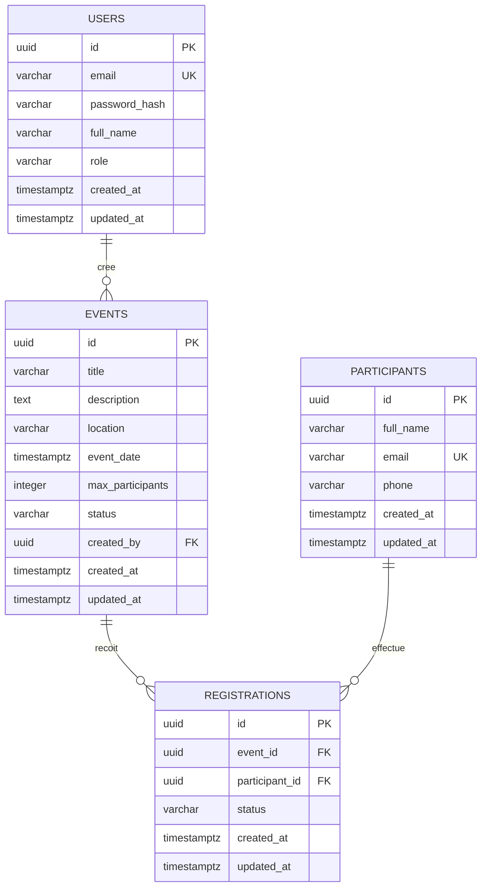

# EventHub - Conception de la base de données

Ce document décrit le modèle relationnel défini dans [`backend/db/schema.sql`](../backend/db/schema.sql). La base cible PostgreSQL 13 ou une version ultérieure.

## Diagramme ERD

Un utilisateur peut créer plusieurs événements. Les participants et les événements sont liés en N-N par `registrations` ; la contrainte unique sur le couple `(event_id, participant_id)` interdit une inscription en double au même événement.

## Tables et relations

### `users`

Comptes de connexion et propriétaires des événements.

| Colonne | Type | Règle |
| --- | --- | --- |
| `id` | UUID | Clé primaire, générée par `gen_random_uuid()` |
| `email` | `VARCHAR(255)` | Obligatoire, unique, format email vérifié |
| `password_hash` | `VARCHAR(255)` | Obligatoire ; contient le hash bcrypt, jamais le mot de passe en clair |
| `full_name` | `VARCHAR(150)` | Obligatoire |
| `role` | `VARCHAR(10)` | Obligatoire, défaut `staff`, valeurs `admin` ou `staff` |
| `created_at`, `updated_at` | `TIMESTAMPTZ` | Obligatoires, initialisés à `now()` ; `updated_at` est maintenu par trigger |

### `events`

Événements créés par les comptes utilisateurs.

| Colonne | Type | Règle |
| --- | --- | --- |
| `id` | UUID | Clé primaire, générée par `gen_random_uuid()` |
| `title` | `VARCHAR(200)` | Obligatoire, non vide après suppression des espaces |
| `description` | `TEXT` | Facultative |
| `location` | `VARCHAR(255)` | Obligatoire |
| `event_date` | `TIMESTAMPTZ` | Date et heure obligatoires |
| `max_participants` | `INTEGER` | Obligatoire et strictement positif |
| `status` | `VARCHAR(10)` | Obligatoire, défaut `draft`, valeurs `draft`, `published` ou `cancelled` |
| `created_by` | UUID | Clé étrangère obligatoire vers `users.id`, suppression du compte créateur refusée (`ON DELETE RESTRICT`) |
| `created_at`, `updated_at` | `TIMESTAMPTZ` | Obligatoires, initialisés à `now()` ; `updated_at` est maintenu par trigger |

### `participants`

Personnes susceptibles de s’inscrire aux événements.

| Colonne | Type | Règle |
| --- | --- | --- |
| `id` | UUID | Clé primaire, générée par `gen_random_uuid()` |
| `full_name` | `VARCHAR(150)` | Obligatoire et non vide après suppression des espaces |
| `email` | `VARCHAR(255)` | Obligatoire, unique, format email vérifié |
| `phone` | `VARCHAR(30)` | Facultatif |
| `created_at`, `updated_at` | `TIMESTAMPTZ` | Obligatoires, initialisés à `now()` ; `updated_at` est maintenu par trigger |

### `registrations`

Table de jonction qui porte les inscriptions et leur statut.

| Colonne | Type | Règle |
| --- | --- | --- |
| `id` | UUID | Clé primaire, générée par `gen_random_uuid()` |
| `event_id` | UUID | Clé étrangère obligatoire vers `events.id`, inscriptions supprimées en cascade avec l’événement |
| `participant_id` | UUID | Clé étrangère obligatoire vers `participants.id`, inscriptions supprimées en cascade avec le participant |
| `status` | `VARCHAR(10)` | Obligatoire, défaut `pending`, valeurs `pending`, `confirmed` ou `cancelled` |
| `created_at`, `updated_at` | `TIMESTAMPTZ` | Obligatoires, initialisés à `now()` ; `updated_at` est maintenu par trigger |

## Contraintes et règles métier

- Toutes les clés primaires sont des UUID générés par PostgreSQL via l’extension `pgcrypto`.
- Les adresses email des utilisateurs et des participants sont `UNIQUE` et leur format est contrôlé par une contrainte `CHECK`.
- Les rôles utilisateurs, statuts d’événements et statuts d’inscriptions sont limités par des contraintes `CHECK`.
- `events.max_participants` doit être supérieur à zéro ; le titre de l’événement et le nom du participant ne peuvent pas être vides.
- `registrations (event_id, participant_id)` est unique : un participant ne peut pas être inscrit deux fois au même événement.
- La publication obligatoire avant inscription, le contrôle du nombre de places disponibles et l’annulation des inscriptions lors de l’annulation d’un événement sont appliqués par la couche métier du backend, et non par une contrainte SQL.
- Le service d’inscription verrouille l’événement dans une transaction pour éviter que plusieurs inscriptions concurrentes dépassent sa capacité.
- Un trigger met automatiquement à jour `updated_at` lors de la modification de chaque table qui possède cette colonne.

## Index

| Index | Colonnes / type | Utilisation |
| --- | --- | --- |
| `users_email_unique` | `users(email)` unique | Recherche d’un compte par email et unicité |
| `idx_events_status` | `events(status)` | Filtre par statut |
| `idx_events_event_date` | `events(event_date)` | Tri et filtre par date |
| `idx_events_created_by` | `events(created_by)` | Recherche des événements d’un utilisateur |
| `idx_events_title_trgm` | GIN trigram sur `events(title)` | Recherche textuelle partielle par titre |
| `participants_email_unique` | `participants(email)` unique | Unicité et recherche exacte par email |
| `idx_participants_full_name_trgm` | GIN trigram sur `participants(full_name)` | Recherche partielle par nom (`ILIKE`) |
| `idx_participants_email_trgm` | GIN trigram sur `participants(email)` | Recherche partielle par email (`ILIKE`) |
| `registrations_event_participant_unique` | `registrations(event_id, participant_id)` unique | Empêche les doublons ; index utilisable pour les recherches par événement et participant |
| `idx_registrations_event_status` | `registrations(event_id, status)` | Comptage des places et filtre des inscriptions d’un événement par statut |
| `idx_registrations_participant` | `registrations(participant_id)` | Recherche des événements d’un participant |
| `idx_registrations_created_at` | `registrations(created_at)` | Statistiques d’inscriptions par date |

Les recherches trigram utilisent l’extension PostgreSQL `pg_trgm`, activée dans le script de schéma.
